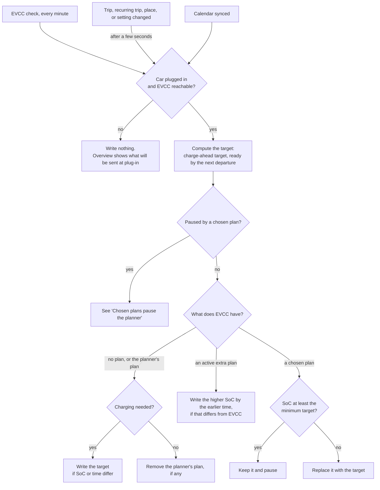
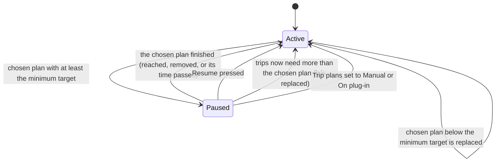
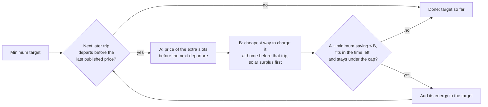
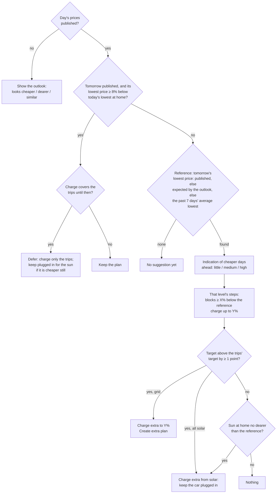
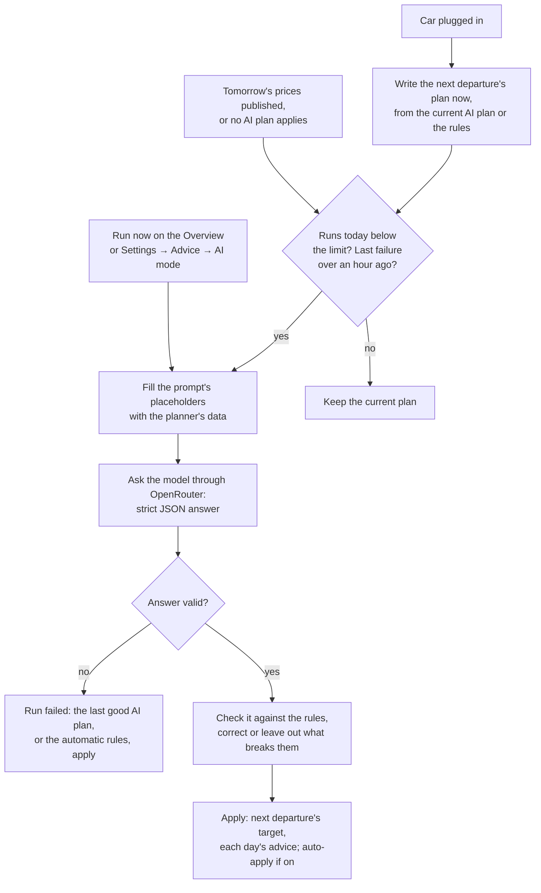
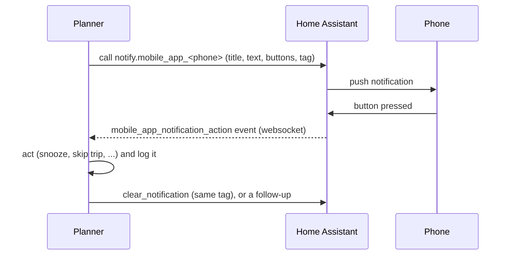

# Automatic plans and notifications

How the planner keeps EVCC's charging plan in line with your trips (V5), and
when it sends notifications to your phone. [PLAN.md](PLAN.md) has the short
version; this file has every rule.

The planner only ever writes the car's **one-off plan** in EVCC: a target SoC
with a ready-by time. EVCC then picks the cheapest slots before that time. The
planner never changes EVCC's mode, its limits, its cheap-charging limit
(except a postponement from daily advice, see V2), or repeating plans.

Plans need EVCC's loadpoint in **Smart** mode while the car is plugged in. In
Off nothing charges, and in Fast EVCC charges at full power right away,
ignoring the plan. The planner warns when it isn't Smart (see
[Problems](#charging-problems-questions-and-ready-messages)), but never
switches it: another automation may set EVCC to Off while the car is away.

## Who does what

The planner decides **how much** charge is needed **by when**; EVCC decides
**when and how fast** to charge.

Example: at 13:00 the car needs 50% by 08:00 tomorrow. This afternoon costs
€0.20/kWh, tonight €0.25/kWh.

- **The planner** writes one plan: 50% by 08:00. Solar never changes the
  target or time for the next departure.
- **EVCC** (Smart mode) picks the cheapest slots before 08:00: this afternoon.
  Solar surplus covers part of that charge and the grid the rest; EVCC sets the
  power from what is produced and used at home.
- With a cheaper night, EVCC plans the night, but still charges from solar
  surplus in the afternoon, so by night it needs fewer slots.

The planner's own solar estimate (below) only decides whether to
[charge later trips ahead](#charge-ahead-for-later-trips), and feeds the
charging estimate on the price chart and the early plug-in reminder. If the sun
disappoints, the automatic check writes the later trip's own target before
it, and the grid fills the gap.

## Three layers of charging

| Layer | What it charges | Where |
| --- | --- | --- |
| 1. **Next departure** | Always its minimum target, by the time it leaves. | The trip plans |
| 2. **Charge ahead** | Later trips today and tomorrow, when charging for them before the next departure is cheaper. | Settings → Planning |
| 3. **Charge extra** | A reserve on top, when today's prices are clearly low. | Daily advice, Settings → Advice |

In [AI mode](#ai-mode) an AI model decides layers 2 and 3; layer 1 stays the
planner's.

EVCC holds one plan, so the planner writes the higher target with the earlier
time. When tomorrow's published prices are clearly lower, the advice is to
**defer**: charge only for the trips (and from the sun, when that is cheaper
still), with no charge extra. Charge ahead already leaves out later trips that
are cheaper to charge for later.

On a day the trip plan charges later trips ahead and the advice has no
charge extra or defer, the advice reads **Charge ahead to 80%** (not "No
plan needed"), with a note that charge extra would come on top; in AI mode
too, where the AI decides both.

## Words used here

| Word | Meaning |
| --- | --- |
| **Next departure** | The first trip (or group of overlapping trips) that hasn't left yet. |
| **Minimum target** | The SoC the next departure needs: its own energy plus the arrival reserve, plus later trips the car can't recharge for in between. This is what V1 shows as "Required departure SoC". |
| **Charge-ahead target** | The minimum target plus later trips that are cheaper to charge for before the next departure (see [Charge ahead](#charge-ahead-for-later-trips)). |
| **Planner's plan** | The last plan the automatic check wrote to EVCC. |
| **Chosen plan** | Any other plan in EVCC: set in EVCC itself, or sent by hand with **Send plan to EVCC**. |
| **Extra plan** | A temporary plan from daily advice (V2), which ends at its expiry. |

## Trip plan modes

Settings → Planning → **Trip plans**:

| Mode | What the planner does |
| --- | --- |
| **Manual** | Nothing on its own. You press **Send plan to EVCC**. |
| **On plug-in** | Once, when the car goes from unplugged to plugged in: sends the target for the next departure, with later trips charged ahead when [Charge ahead](#charge-ahead-for-later-trips) is on. A plan in EVCC with at least that target (chosen, or an extra plan from advice) is kept; a lower one is replaced, and an extra plan it replaces ends. Nothing is sent when the charge already covers the target. |
| **Automatic** (default) | Keeps EVCC's plan matched to your trips at all times, while the car is plugged in. Described below. |
| **AI mode** | Like Automatic, but an AI model decides charge ahead, charge extra, solar, and deferring. See [AI mode](#ai-mode). |

Existing installs: the old "plan when plugged in" switch becomes **Automatic**
when it was on, and **Manual** when it was off.

## The automatic check

- **When it runs:** after every EVCC check (every minute by default), a few
  seconds after you change a trip, recurring trip, place or setting, and after
  each calendar sync. New prices (around 14:00) and plugging in are seen by the
  next EVCC check.
- **What it computes:** one SoC target, ready by the next departure. With
  [Charge ahead](#charge-ahead-for-later-trips) on, that's the charge-ahead
  target; otherwise the minimum target.
- **Charging needed** means the car's live SoC is below the target. When it
  isn't (the charge already covers it, or there's no upcoming trip), the
  planner's own plan is removed; EVCC also removes a plan once it's reached.
- **Only while plugged in:** EVCC uses the plan only then, and while unplugged
  its SoC reads 0. While unplugged, the Overview shows "Sends 64% by Thu 07:45
  when plugged in". The first check after plugging in writes it.
- **No back-and-forth:** a write happens only when the whole-percent target or
  the ready-by minute differs from EVCC's plan. Charge-ahead decisions need a
  clear price gap to start (see below).
- **Activity log:** every write, removal, pause, and resume, with source
  "Automation". Checks that change nothing are not logged.
- **EVCC unreachable:** nothing is written; EVCC keeps its plan, and the next
  check tries again. The same holds when EVCC's last answer is too old (see
  [When data is too old](#when-data-is-too-old)).

## Chosen plans pause the planner

A chosen plan is a plan someone picked: set in EVCC, or sent with **Send plan
to EVCC** in the planner. The planner respects it as long as it covers the
next departure.

- **Pause:** in Automatic mode, a chosen plan with at least the minimum target
  pauses automatic changes. It's kept even when its ready-by time is after the
  next departure. The Overview shows "Paused: plan chosen in EVCC Tue 20:14
  (80% by Wed 07:00)" with a **Resume** button.
- **Too low:** a chosen plan below the minimum target is replaced with the
  planner's target right away; trip needs come first. To stop the planner,
  set Trip plans to Manual, turn the trip off, or set EVCC's mode to Off.
- **Resume on its own:** when the chosen plan is gone (EVCC removes a plan once
  it's reached or its time has passed, or someone removed it), automatic plans
  resume and the same check writes the next target.
- **Resume button:** confirms what will be replaced, then checks right away.
- **EVCC not in Smart mode:** not a pause. The planner never changes the mode;
  while the car is plugged in it warns that the plan won't be followed (see
  [Problems](#charging-problems-questions-and-ready-messages)).

## Extra plans from daily advice

EVCC holds one plan per vehicle, so an active extra plan and the trip target
share it:

- **Merge:** the planner writes the higher SoC with the earlier ready-by time.
  When the extra plan already covers the trip target by the departure, nothing
  is written.
- **Extra plan after the next departure:** an extra plan ready after the next
  departure (an AI window that starts after the evening's trips) waits. Until
  that trip has left, EVCC gets the trip's own plan when it needs charge, so
  the extra charge isn't pulled before it; after it, the extra plan. Example:
  charge extra to 70% from 23:00 to 05:00, with trips at 15:00 and 20:00: the
  plan is made right away as 70% by 05:00; plugged in below the 15:00 trip's
  target, EVCC gets that trip's plan; plugged in after the 20:00 trip, 70% by
  05:00.
- **Already reached:** an extra plan the car's charge already reaches is not
  written (EVCC drops a reached plan); it comes back when a trip has used
  the charge.
- **End:** at expiry (or **End now**) the earlier plan comes back, or the extra
  plan is removed, as in V2. In Automatic mode the check then takes that plan
  over as its own: once the car is plugged in it updates it to the current
  trip target, or removes it when nothing needs it.
- Sending a trip plan by hand ends an active extra plan, as in V2.
- Advice auto-apply stays a separate setting (Settings → Advice), off by
  default.

## Charge ahead for later trips

"Charge ahead" is only this trip feature; the daily advice's extra charge is
called **charge extra** (until 2026-11-17 it was also called charge ahead).

With **Charge ahead for later trips** on (On plug-in and Automatic mode, and
AI mode while no AI plan applies; never Manual), the target can
include trips after the next departure, when charging for them before the
next departure is clearly cheaper.

- **How far ahead:** up to the last published price in EVCC (usually 24–36
  hours after the ~14:00 update). Later trips keep their own minimum targets.
- **Order:** later trips are checked in date order. The first one that isn't
  cheaper ahead (or doesn't fit, or would pass the cap) ends the check, so the
  target always covers a run of trips without charging in between.
- **A, charge before the next departure:** the extra 15-minute slots the trip
  would need, after the slots the earlier energy already uses, cheapest first,
  between now and the next departure (minus the charging time buffer).
- **B, charge at home just before that trip:** the cheapest way to charge the
  same energy in the home periods between the next departure and that trip.
- **Solar comes first.** No tax is paid on your own solar energy, so a solar
  kWh counts as the grid price at that moment minus **Tax not paid on own
  solar** (default €0.11/kWh). Solar during a €0.20 slot costs €0.09, which
  beats night charging at €0.15.
- **Solar charges at the surplus rate.** Per 15-minute slot, the surplus is the
  solar forecast minus the household use setting. The car charges from it at
  that rate, not at the charger's full power: 2 kW of surplus adds about 1.8
  kWh per hour to the battery. Only the charger's remaining capacity in that
  slot counts as grid energy, at the full price. Surplus below the charger's
  minimum (6 A of 16 A, so about 1.4 kW at 3.68 kW) counts as none, as EVCC
  can't charge below it. A trip's energy is filled from the cheapest pieces first,
  usually solar, so a modest sunny day covers part of a long trip and the
  rest is priced at grid rates. The same valuation applies to both A and B.
- **Limits:** household use is one number for the whole day, while real use
  varies by hour; and EVCC picks the actual slots. The estimate assumes EVCC
  charges from solar between planned slots (Smart mode). Learning an hourly
  household profile from Home Assistant's history could come later.
- **Minimum saving** (default €0.05/kWh): A must be at least this much cheaper
  than B to start charging a trip ahead. Once a trip is charged ahead, it stays
  included while A is still no dearer than B, so small price changes don't
  flip the target back and forth.
- **Cap** (default 90%): charge ahead never raises the target above it. A
  trip's own minimum target can still go up to 100%.
- **Unknown SoC:** no charge ahead; the minimum target is used.
- The energy is in SoC points of the usable capacity; grid energy includes
  charging losses. Prices are EUR/kWh including VAT.

**Example.** Plugged in Wednesday 21:30 at 30%. Thursday: school run at 07:45
(uses 12%, home by 08:45) and Utrecht at 17:00 (uses 37%). The night slots for
the extra charge average €0.23/kWh; the cheapest Thursday daytime slots average
€0.31/kWh, with little sun. (On a sunny Thursday, solar during €0.25 slots
would count as €0.14/kWh, and Utrecht would be charged from the sun instead.)

- Minimum target: 27% (12% + 15% reserve). 30% covers it, so no plan.
- Utrecht ahead: A = €0.23 + €0.05 ≤ B = €0.31, so it's added: 12% + 37% + 15%
  = **64% by Thu 07:45**.
- The Overview says: "Target 64% by Thu 12 Nov, 07:45. Includes Utrecht (Thu
  12 17:00): €0.23/kWh before the next departure vs €0.31/kWh before it, saves
  about €1.94."

EVCC still picks the actual slots. The planner shows its own estimate of them
on the price chart, labelled as an estimate.

## Charge extra (daily advice)

Daily advice gives one recommendation for each day with **published prices**
(today, and tomorrow from about 14:00): **Defer**, **Charge extra**, **Charge
extra from solar**, or nothing. Later days only show what the weekly outlook
expects ("Looks cheaper", "Looks dearer", "Similar"); their signals feed the
indication below.

- **Blocks:** the day's quarter-hours while the car is home, from now (today)
  until the plan's deadline: the end of the day, or the next departure minus
  the charging buffer. Each splits into its solar surplus (forecast minus
  household use, above the charger's minimum), counted at the **slot price
  minus the tax not paid on own solar** (€0.11/kWh), and the rest from the
  grid at the slot price, as in [charging ahead](#charge-ahead-for-later-trips).
- **Reference:** tomorrow's **lowest published price** when all of tomorrow
  is published. Before that, the strongest of:
  1. the lowest the **weekly outlook** expects for tomorrow from its
     **estimate** for that day;
  2. the **average of each day's lowest price over the past 7 days** (the
     [price history](FEATURES.md#price-history), complete days only), with a
     full week;
  3. the lowest the outlook expects for tomorrow from its **weekly average**;
  4. that history with 3 to 6 days.

  The outlook gives daily averages, so its value is scaled by the advised
  day's own lowest-to-average ratio (bounded to 0.3–1). Example: Wednesday's
  prices average €0.30 with a lowest of €0.22, and the outlook's weekly
  average is €0.40, so Thursday's expected lowest is about €0.29 (€0.40 ×
  0.73). Without any of these there is no suggestion yet.
- **Discount** of a block: (reference − its price) / the reference (at least
  €0.01). Blocks at or below **€0** count for every step: −€0.20 is cheaper
  than −€0.10.
- **Indication of cheaper days ahead**, from the days after the reference that
  have at least an hour at home: a day signals cheaper prices with an outlook
  estimate at least 8% below today's average (or ranked the week's cheapest),
  or with wind (KNMI Bft 5, or high market wind) or sun (60% of possible
  sunshine, or 5% of SoC from EVCC's forecast) unless its estimate is 8%
  dearer. **High:** a cheaper estimate together with wind or sun. **Medium:**
  one of them. **Little:** none, or no data.
- **Steps** (Settings → Advice), per indication; each can be switched off.
  Defaults:

  | Indication | On | Step 1 | Step 2 | Step 3 |
  | --- | --- | --- | --- | --- |
  | Little | yes | 20% cheaper → 50% | 30% → 80% | 50% → 100% |
  | Medium | yes | 30% → 40% | 45% → 60% | 60% → 80% |
  | High | no | 40% → 30% | 60% → 50% | 75% → 70% |

- **Realistic target:** each step charges up to its target with only the
  blocks at least its discount below the reference, as far as those blocks
  can (start SoC + what they add). The step that reaches highest wins; on a
  tie the deeper discount. It applies when that target is at least a point
  above both the start SoC and the trips' target (with charge ahead). Example:
  only four quarter-hours (1 h) are half the reference: the 100% step adds
  about 6%, so the advice is "Charge extra to 46%". With an unknown SoC the
  advice shows the step's target and says so.
- **Charge extra** offers **Create extra plan** with that target (confidence
  2 or 3), ready when its cheap blocks end (or by the next departure) and
  ending then, so the previous plan comes back. Auto-apply uses the same. The advice lists the blocks: "Charge extra to 60%: about 4 h between
  00:15 and 05:45 average €0.17, 45% or more below this week's lowest prices
  (€0.40)."
- **Charge extra from solar:** when the step's charge is all solar, or the sun
  at home is no dearer than the reference even without a step: "Today's sun
  charges at about €0.16/kWh, or €0.05 without the tax you don't pay on own
  solar: no more than tomorrow's lowest (€0.20). Keep the car plugged in."
  No plan: EVCC charges from the sun by itself in Smart mode, so the advice
  only asks to keep the car plugged in from the first to the last useful slot.
  It offers no Create extra plan, and advice auto-apply ignores it.
- **Negative prices with sun:** exporting solar then costs money. The advice
  says so with the times: keep the car plugged in to use the sun (and switch
  the panels off if nothing can use it), or, while the car is away, use the
  solar another way or switch the panels off.
- **Trips that miss cheap blocks:** blocks during a trip at or below €0, or as
  cheap as the level's top step and clearly (8%) cheaper than any time at home
  that day, add a hint: "−€0.04/kWh 13:00–13:30 while you're away (Dentist):
  consider moving the trip to charge then."
- **Defer** (published prices only, before charge extra): tomorrow's lowest is
  at least 8% below today's lowest at home (all of the day's time at home, not
  only until the next departure) and the charge covers the trips
  until then. **Review postponement** pauses EVCC's cheap-grid charging until
  then (today only). With sun no dearer than tomorrow's lowest, the advice adds
  to keep the car plugged in for it; otherwise there is no need to. Estimates
  never defer.
- **Sun too weak to charge:** when the day has at least 3 kWh of sun while the
  car is home but none of it reaches the charger's minimum above household
  use (6 of 16 A, about 1.4 kW at 3.68 kW), the advice's Why? says so.
- **Confidence:** 3 against tomorrow's published prices, 2 against the
  outlook or a week of price history, 1 against a stale outlook or a shorter
  history. Plan actions need 2; auto-apply needs its minimum confidence (3 by
  default, so it acts on the outlook or the history only when set to 2).
- Less than 1% of SoC is not worth advising on.

## When new prices arrive

EVCC publishes tomorrow's prices around 14:00. The automatic check (and in
AI mode a new AI plan) picks them up within a minute, so the target for the
next departure follows them: charge ahead may add or drop later trips, and
EVCC re-picks its cheapest slots by itself. Once per publication, the
planner also:

- **Plans made automatically from advice follow the new advice.** An extra
  plan created by auto-apply is replaced when the advice's target or ready-by
  time changed, and ended (the previous plan comes back) when the advice no
  longer charges extra. An automatic postponement ends when today's advice
  is no longer to defer. Auto-apply then runs at once instead of within 15
  minutes.
- **A plan you ended is the day's decision, until something new.** Auto-apply
  makes one plan per day's advice: one you end (**End now**) is not made
  again by itself. In Automatic and AI mode, new prices and (AI mode) each
  new AI plan, also one run by hand or after a plug-in, ask again: auto-apply
  then acts on the new advice, and a plan ended after that stays ended until
  the next one. In On plug-in mode it stays once a day.
- **Plans you chose are raised, never lowered** (Automatic and AI mode). A
  plan set in EVCC or sent by hand, which pauses automatic plans, is raised
  to the planner's target when that is higher now: the higher SoC by the
  earlier time; it stays the chosen plan. An extra plan you created is
  raised to the new advice's higher charge extra target, keeping its ready-by
  time. Outside a publication the usual pause rules apply.
- **Says so while the car is unplugged** (Automatic and AI mode): when the
  target for the next departure changed, or the prices bring charge extra, a
  **New prices: plug in** notification goes out (see
  [Problems](#charging-problems-questions-and-ready-messages)).

The first check after a start only learns where the prices end.

## AI mode

AI mode works like Automatic: the same check keeps EVCC's plan in line with
the trips, chosen plans pause it, and extra plans merge with it. The
difference is who decides the parts that are about money: an AI model,
through OpenRouter, chooses the target for the next departure (charge ahead
and any reserve) and each day's advice (charge extra, charge extra from
solar, defer, or nothing), with how much and when.

- **What it decides:** the SoC to have when the next trip leaves (at least
  that trip's own target; it may add later trips, or a reserve when the
  coming days drive more than usual or take a large part of the battery),
  and one recommendation per day: charge extra to a target in a window with
  published prices; charge extra from solar in a window (keep the car
  plugged in); defer until a later day, and for today whether to pause
  EVCC's cheap-grid charging; or nothing. Each with a confidence (1–3), a
  summary, and reasons, plus the inputs that mattered most. For how much to
  charge extra, the default prompt gives a rough guide with example values
  (about 20% cheaper → around 50%, 30% → around 80%, 50% or negative → up to
  100%; less when the coming days look cheap too). Your steps under Settings
  → Advice are not sent: in AI mode they only apply while no AI plan does.
- **What stays the planner's (foundational rules):** every departure's own
  minimum target is charged whatever the AI says, also right when the car
  is plugged in (the plan is written before the AI is asked); charge ahead
  stays at or below **Highest target when charging ahead**; a chosen plan
  pauses it as in Automatic; EVCC's limits, mode, and repeating plans are
  never touched.
- **Acting on the AI's advice:** the AI's daily advice always shows (the
  automatic rules' part of Settings → Advice doesn't apply in AI mode). With **Automatically create plans
  from the AI's advice** (Settings → Advice → AI mode) off, it offers **Create extra plan**
  and **Review postponement**; on, they are made on today's AI advice at
  its minimum confidence, once until the next AI plan or new prices (see
  [When new prices arrive](#when-new-prices-arrive)) (postponing only with **Also postpone**
  and when the AI asks for it). It never acts on the automatic rules' advice
  shown until the first AI plan. The AI's target for the next departure
  applies either way. Until you change it in AI mode, this switch (with its
  minimum confidence and Also postpone) follows the one under Automatic
  rules. After each AI plan, auto-apply runs before the plan check, so when
  the AI moves charge from charge ahead to charge extra, the extra plan
  replaces the planner's plan in EVCC directly. The extra plan is ready when
  the AI's window ends. When that window starts after the next departure,
  the plan keeps the first departure after the window starts, and the trips
  before it keep their own plans first (see
  [Extra plans from daily advice](#extra-plans-from-daily-advice)); it is
  still made right away. The AI is told whether its
  charge extra becomes a plan by itself; if it needs confirmation, it is
  asked to charge the trips' energy through charge ahead.
- **Checks** (each correction is listed with the run under "Corrected by the
  planner"): a target below the next departure's own is raised to it, one
  above the cap is lowered to it; later trips it names must exist; charge
  extra needs a target (10–100%) and a window that starts on its day, now or
  later, within the published prices (it is cut at the last published
  price), at most a day long; charge extra from solar needs a window on a
  day with EVCC's solar forecast and enough surplus to charge; defer needs a
  later day of the plan, and only today may pause cheap-grid charging; days
  outside the plan are left out. Prices, energy, and solar figures shown
  with the advice are the planner's own, never the model's.
- **When it runs:** when EVCC publishes prices beyond the last AI plan's
  (tomorrow's, around 14:00), when no AI plan applies (such as right after
  choosing AI mode), and after a plug-in, each switchable; at most **Runs
  per day** (3) in a local day. Every run counts, also those by hand, which
  are always allowed. The day's last run waits for tomorrow's prices until an
  AI plan has seen them, so plug-ins can't use it up. A failed automatic run
  is tried again after an hour; a plug-in without a run is noted in the
  activity log.
- **Fallback:** until the first AI plan, when the last one is more than 30
  hours old, after it was made for an earlier departure (for that target),
  or without an OpenRouter key, the automatic rules apply, and the Overview
  says so.
- **The prompt** is edited under Settings → Advice → AI mode and is sent as the user
  message after a fixed system message that sets the answer's format (a
  strict JSON Schema) and states the checks. Placeholders in double braces
  are filled with the data when it is sent; unknown placeholders can't be
  saved. A prompt equal to the default is stored as the default, so it
  follows later changes. **Preview with today's data** fills it without
  sending.

| Placeholder | Holds |
| --- | --- |
| `{{now}}` | The date and time (Europe/Amsterdam). |
| `{{goals}}` | The **Goals** field (Settings → Advice → AI mode). By default the planner's rules with your settings (reserve, charge-ahead cap, EVCC's charge limit as a battery-care preference, the rules' minimum saving), following them when they change; once edited, your text. |
| `{{vehicle}}` | Usable battery, charging power and efficiency, consumption, charging buffer, household use, the charger's least solar surplus, the tax not paid on own solar. |
| `{{state}}` | The SoC (source and time), plugged in or charging, the car's location, EVCC's mode, plan, and cheap-grid limit, active extra plans and postponements, the next trip and its minimum. |
| `{{trips}}` | Away periods of the next 7 days as T1, T2, … with their names (the trips' titles, e.g. T1 "BSO pick-up"): when the car leaves, arrives, and is back home; km, kWh, and SoC used; the minimum SoC to leave with. No places or addresses. The AI uses the IDs in its answer and the names in its text. |
| `{{daily_needs}}` | Per day: trips, km, kWh, the charge its departures need, the first departure's target, and the hours at home. |
| `{{energy_prices}}` | EVCC's published prices, every slot, per hour, marking hours the car is away, with each day's lowest, average, and highest. |
| `{{solar_forecast}}` | EVCC's local solar forecast per hour (today and tomorrow), with each day's kWh in total and while the car is home, and per hour the surplus the car can use and what its kWh costs (the hour's price minus the tax not paid on own solar), or "too little to charge". |
| `{{tibber_outlook}}` | Tibber's weekly outlook: period, summary, trend, weekly average, and each day's estimate, level, wind, and sun. |
| `{{weather}}` | KNMI's outlook per day: wind, sunshine, temperature, rain chance. |
| `{{history}}` | The past 30 days from the price history (prices, driving, energy, wind, sun) with their averages. |
| `{{automatic_plan}}` | What the automatic rules would do, for comparison (not in the default prompt). |

- **Notifications** are the same as in Automatic, with the AI's advice in
  them; in AI mode the title of every message about charging ends with
  "(🤖 AI mode)" (all but test messages and questions about calendar
  events): "[EVCC Planner] 🔌 Extra plan created (🤖 AI mode)".
- **Activity log:** every run (`ai.run`, with its trigger, model, and tokens;
  failed runs as failures) and a plug-in without a run (`ai.skip`). Each run
  keeps the prompt as sent and the model's answer (Settings → Advice → AI mode, **What was
  sent and what came back**); runs are deleted with the activity log, keeping
  the last good one.
- **Model:** any OpenRouter model with strict structured outputs (default
  `~anthropic/claude-haiku-latest`; e.g. `~openai/gpt-luna-latest`), separate
  from the forecast's model under Settings → Connections. Without `OPENROUTER_API_KEY` there are
  no runs; demo mode has a labelled stand-in that repeats the automatic
  rules.
- **Cost:** the default prompt with a week of data is about 3,000 tokens, the
  answer about 1,000; three runs a day.

## Notifications

Notifications go to the Home Assistant Companion app on your phone. They're
off until you turn them on and choose a phone in Settings → Notifications.

- **Sending:** the planner calls Home Assistant's notify service for each
  chosen phone with the `HA_TOKEN` it already uses. Each message has a title,
  text, up to three buttons, and a tag. Every title starts with
  "[EVCC Planner]" and an emoji for its kind, so it stands out on the phone:
  "[EVCC Planner] ⏰ Plug in by 06:36" (🔔 test, 🔌 early reminder and extra
  plan created, ⏰ urgent, 🚨 too late, ⚠️ problems, ❌ missed target, ❓
  question, ✅ ready, ☀️ sun, 🔋 charge extra, 🏠 back home, 💶 new prices,
  ⏭️ trip skipped). A newer message with the same tag
  replaces the old one on the phone; when a message is no longer relevant, the
  planner clears it.
- **Failed sends:** when no phone gets a message (Home Assistant unreachable,
  say), it is tried again after 2, then 5, then 15 more minutes, and given up
  after the fourth failed try. Meanwhile it counts as open, so the usual rules
  end it once it's no longer needed (plugged in, the trip left, a newer
  reminder). It is also given up past its latest time (such as the latest
  plug-in time), in quiet hours it may not come in, and when the planner
  couldn't try within 15 minutes of its time (EVCC data too old, the app
  stopped). The activity log has the first failure and the outcome, not every
  try. Settings → Notifications lists it as "Trying again", and Settings →
  Connections shows the last failure until a message gets through. A test
  notification is not tried again: its error shows right away.
- **Phones:** Settings → Notifications lists Home Assistant's
  `notify.mobile_app_*` services to choose from.
- **Button presses:** the planner keeps a websocket connection to Home
  Assistant and listens for `mobile_app_notification_action` events. No Home
  Assistant automation or YAML is needed, and Home Assistant never has to reach
  the planner. The connection reconnects on its own.
- **Admin token for buttons:** Home Assistant only lets administrators
  subscribe to these events (and to triggers), so the token's user must be an
  administrator. Any user can send notifications: with a non-admin token they
  arrive, but buttons do nothing, and Settings → Connections says so.
- **View plan** opens the planner, using the **Link address** setting (the
  address your phone uses to reach it). Without one, that button is left out.
- **Test:** **Send test notification** in Settings sends one right away.
- **What they say:** an info icon next to each setting in Settings →
  Notifications shows, on hover or tap, the title, message, and buttons of
  its notifications, with `{…}` for what is filled in when sent and `[…]`
  for parts that only appear when they apply. The copy lives in
  `internal/service/notifycopy.go`; API tests fail when a notification they
  send doesn't match it.
- **Activity log:** every message sent (or failed) and every button press,
  with source "Notification" for presses. Tokens never appear.
- **Demo mode:** a stub records the messages; Settings → Notifications shows
  them with their buttons, which act like a press on the phone.
- **Telegram:** a possible alternative in V8, using the same rules (see
  [PLAN.md](PLAN.md)).

## Plug-in reminders

Reminders only go out when all of these hold:

- notifications are on, with a phone chosen;
- the car is unplugged, according to a current EVCC reading;
- no trip is in progress, and (if a car location sensor is set) the car is
  home;
- the plan needs charging before the next departure.

| Reminder | When | Example |
| --- | --- | --- |
| **Early** | 30 min before the first slot of the planned charging (the planner's estimate of EVCC's cheapest slots for the target). If that falls in quiet hours, 15 min before quiet hours start; if that has passed too, when quiet hours end, while the planned charging is still ahead. | "Plug in tonight: charging is cheapest from 01:00 (€0.21/kWh) for Thursday's trips." |
| **Urgent** | 30 min before the latest plug-in time: the next departure, minus the charging time buffer, minus the time to charge the minimum target. | "Plug in by 10:20 to have 52% for Utrecht at 17:00." |
| **Too late** | Once, after the latest plug-in time, if the car is still unplugged. | "Plugging in now gives about 46% by 17:00 (Utrecht needs 52%)." |
| **Back home** | The car location sensor turns `home` (from elsewhere, within the last 30 min) after the day's last trip: no other trip leaves later that day, whether or not the trip was planned. The car is unplugged and still needs charging: for the next departure, for later trips charged ahead, or for a [charge extra](#charge-extra-daily-advice) plan (today's or tomorrow's). Once per arrival, in every trip plan mode. It comes in quiet hours too, right after the car arrives home, unless **Also in quiet hours** under it is unchecked; that check is separate from urgent reminders, and also applies when it is snoozed. Needs the car location sensor. Charge extra counts only once no trip before its cheap hours is left (see below). Buttons: **Remind in 30 min**, **View plan**. | "Back home: plug in. School drop-off needs 42% by Tue 07:48. Charge extra to 50%: 02:00–05:45 averages €0.23 …" |

The early reminder is about saving money, so it uses the full target. Urgent
and too-late reminders only use the minimum target.

```mermaid
gantt
    title Unplugged Thursday morning, Utrecht at 17:00 needs 34 more SoC points (about 6 h)
    dateFormat HH:mm
    axisFormat %H:%M
    section Car
    Home, unplugged          :08:45, 10:20
    Charging must start      :milestone, 10:20, 0m
    section Reminders
    Urgent reminder          :milestone, 09:50, 0m
    Too late (if still unplugged) :milestone, 10:20, 0m
```

- **Buttons:** **Remind in 30 min**, **Skip trip**, **View plan**.
  - *Remind in 30 min* sends it again after the snooze time, but never later
    than the latest plug-in time.
  - *Skip trip* turns that trip off, as in the UI, re-plans, and confirms:
    "Skipped Utrecht; the new target is 27%."
- **Plugging in** cancels pending reminders and clears them from the phone.
- **After a back-home reminder** the early, sun, and charge extra reminders
  wait 30 minutes, so they don't arrive right after it; a later plug-in
  reminder replaces it on the phone. It also ends when the car leaves again.
- **No duplicates:** each reminder has one key (kind + trip + time), saved in
  the database, so a restart doesn't resend it. When its details change, the
  same phone notification is updated.
- **Quiet hours** (default 23:00–07:00): early reminders and questions wait
  (or are skipped when their moment has passed). Urgent and too-late reminders
  follow **Urgent reminders in quiet hours**: send (default) or wait until
  quiet hours end. The back-home reminder follows its **Also in quiet hours**
  check: send (default) or skip.

## Charging problems, questions, and ready messages

| Message | When | Example |
| --- | --- | --- |
| **Charging stopped** | Plugged in below the next departure's minimum target, EVCC says the plan is charging now, but the car hasn't charged for 10 minutes. | "Charging stopped at 48%; Utrecht needs 52% by 17:00." |
| **Unplugged early** | Unplugged more than 30 minutes before the next departure, below its minimum target. | "Unplugged at 48%; Utrecht needs 52% by 17:00." |
| **Not in Smart mode** | Plugged in below the next departure's minimum target, with EVCC's mode Off or Fast for 10 minutes (the mode may be switched back to Smart soon after the car arrives). The Overview warns right away. Never while unplugged. | Off: "The plan won't run; Utrecht needs 52% by 17:00. Set EVCC to Smart." Fast: "It charges at full power now, not in the plan's cheapest slots or from solar." |
| **Missed target** | Unplugged within 30 minutes of the departure with less than its minimum target. Also an activity entry, even with notifications off. | "Left for Utrecht with 48% (target 52%)." |
| **Question** | A calendar event marked Needs review, within the seven days. Buttons: **Count it** (confirm) and **Not a trip** (turn off). | "Is 'Dinner' (Thu 19:00) a car trip?" |
| **Ready** (off by default) | Plugged in and the target reached before the departure. | "Ready for Utrecht: 64%." |
| **Plug in for the sun** | Today's advice is to [charge extra from solar](#charge-extra-daily-advice), the car is home (no trip in progress; at home by the car location sensor, if set) and unplugged, from 30 minutes before the solar surplus starts until 30 minutes before it ends, outside quiet hours. Any confidence: plugging in changes nothing in EVCC by itself. Buttons: **Remind in 30 min** (never after the sun's end), **View plan**. | "Plug in for the sun: Sunshine until about 14:30 charges the car at about €0.16/kWh (€0.05 without the tax on own solar), no more than tomorrow's lowest price. Plug in to use it." |
| **Plug in for charge extra** | Today's or tomorrow's advice (the first whose cheap hours are still ahead) is to [charge extra](#charge-extra-daily-advice) with a plan (offered, or created by hand or automatically), the car is home and unplugged, from 30 minutes before its cheap hours start until 30 minutes before they end, outside quiet hours. When that start falls in quiet hours, such as a cheap night, it comes from 15 minutes before quiet hours instead. Once a day; cleared when the car is plugged in or the cheap hours are over. Without the plan yet it also asks to create it, or says that automatic plans create it when the day starts. Not while a trip that leaves before the cheap hours is still ahead or under way (by the car location sensor, if set, it is over once the car is home): the car leaves again first, so it comes once the car is back from the last of them, if that is before quiet hours (later, the back-home reminder still asks). Buttons: **Remind in 30 min**, **View plan**. | "Plug in for charge extra: Charge extra to 71%: 18:30–00:00 averages €0.28, 30% or more below this week's lowest prices (€0.40). Plug in so the plan can charge." |
| **New prices: plug in** | Automatic and AI mode: tomorrow's prices (around 14:00) change the target for the next departure, or bring charge extra (today's or tomorrow's; not while a trip before its cheap hours is still ahead), while the car is unplugged. Once per publication, outside quiet hours; cleared when the car is plugged in. Button: **View plan**. | "New prices: plug in: The plan for School drop-off is now 64% by Tue 07:48 (was 42%), also for School pickup. Plug in so it can charge." |
| **Extra plan created** | Advice auto-apply created an extra plan, outside quiet hours (in them, only the activity log has it). Information only. Button: **View plan**. | "Extra plan created: Charge extra to 71%: 18:30–00:00 … The plan asks EVCC for 71% by Mon 00:00 and ends then." |

Each is sent once per trip (unplugged early: once per unplug; not in Smart
mode: once per mode; plug in for the sun: once per day). Charging stopped, not
in Smart mode, and plug in for the sun are cleared from the phone once solved
(for the sun: plugged in, or the sun is gone). Settings turn problems,
questions, ready messages, and solar reminders on or off separately.

## When data is too old

Each source has one rule: how old its data may be, what the planner does when
it is older, and where you see it. "Health line" is the warning line at the
top of the Overview; every connection also shows its last success under
Settings → Connections.

| Source | Too old after | What the planner does | Where you see it |
| --- | --- | --- | --- |
| EVCC (live SoC, prices, plan) | No answer at the last 3 checks (3 minutes by default) | No automatic plan changes, reminders, or AI runs; **Send plan** is off | Ready card ("EVCC unreachable: no answer since 10:12"), EVCC's connection, health line |
| Published prices | When a slot has ended | Ended slots aren't used; days without published prices use estimates | Charts and the week (estimates dashed) |
| SoC reading (not live) | 3 hours | Still planned with | Ready card: "Last known, … from Home Assistant" |
| Home Assistant | No answer at the last 3 checks (30 minutes by default) | The SoC comes from EVCC while plugged in, otherwise the last known | Its connection, health line |
| Calendars | No sync for 3 syncs (3 hours by default) | Trips stay as last synced | Its connection ("6 events, last synced 19:00"), health line |
| Tibber outlook | No fetch for 2 days; contents older than 8 days or past their week | Advice keeps the last outlook; from old contents with confidence 1 | Its connection and the health line (fetch); the advice's sources (contents) |
| KNMI weather | No fetch for 2 days; an outlook issued more than 36 hours ago | Advice keeps the last outlook, marked stale | Its connection and the health line (fetch); the advice's sources (outlook) |
| AI plan | 30 hours | The automatic rules apply | AI plan row on the Overview |
| Background checks | A check hasn't run for 3 of its intervals, and at least 10 minutes | Nothing automatic happens until the planner is restarted; `/readyz` fails, so the container shows as unhealthy | Health line ("The EVCC check last ran at 10:12"), Docker or Portainer |

## Settings

Settings has Planning, and Advice with two parts: **Automatic rules** (the
rules' advice, for Manual, On plug-in, and Automatic) and **AI mode**. The
saved mode's part opens first. The trip plan mode
decides which of their parts apply; the others are shown greyed out with the
reason, and keep their values for when you switch back.

| Setting | Manual | On plug-in | Automatic | AI mode |
| --- | --- | --- | --- | --- |
| Charge ahead, minimum saving | greyed | ✓ | ✓ | ✓ while no AI plan applies |
| Highest target when charging ahead | greyed | ✓ | ✓ | ✓ (also limits the AI) |
| Household use, tax not paid on own solar (Home & vehicle) | ✓ | ✓ | ✓ | ✓ |
| Advice → Automatic rules: daily advice, charge extra steps | ✓ | ✓ | ✓ | greyed (the AI's advice always shows; the steps still shape the rules' advice until the first AI plan) |
| Advice → Automatic rules: act on the advice automatically | greyed | ✓ | ✓ | greyed (AI mode has its own) |
| Advice → AI mode, with acting on the AI's advice | greyed | greyed | greyed | ✓ |

Settings → **Home & vehicle**, under Solar at home (every mode uses them:
the advice, the chart's charging estimate, AI mode's data):

| Setting | Default | Notes |
| --- | --- | --- |
| Household use during the day | 0.4 kW | Subtracted from the solar forecast. |
| Tax not paid on own solar | €0.11/kWh | A solar kWh counts as the grid price minus this. |

Settings → **Planning**:

| Setting | Default | Notes |
| --- | --- | --- |
| Trip plans | Automatic | AI mode, Automatic, On plug-in, or Manual. |
| Charge ahead for later trips | On | Not in Manual mode; in AI mode only while no AI plan applies. |
| Minimum saving | €0.05/kWh | How much cheaper ahead must be to start. |
| Highest target when charging ahead | 90% | Trip needs alone may go higher. Also limits the AI. |

The Planning tab also shows whether automatic plans are active or paused,
with **Resume**, and in AI mode whether an AI plan is in use.

Settings → **Advice → Automatic rules** (greyed out in AI mode):

| Setting | Default | Notes |
| --- | --- | --- |
| Daily advice | On | Shows a recommendation for each published day. AI mode always shows the AI's. |
| Charge extra steps | See [Charge extra](#charge-extra-daily-advice) | Per indication of cheaper days ahead: on/off and three steps (% cheaper → target SoC). |
| Automatically create plans from daily advice | Off | Once on today's advice (again after new prices in Automatic mode): charge extra's target, ready when its cheap hours end (or by the next departure), and ended then. On plug-in and Automatic mode only (AI mode has its own, under AI). The next trip's plan and charge ahead come from the trip plan mode, not from here. |
| Minimum confidence | 3 | 2 also acts against the weekly outlook or a week of price history. |
| Also postpone | Off | Pauses cheap-grid charging when today's advice is to defer. |

Settings → **Advice → AI mode** (see [AI mode](#ai-mode); greyed out in the other modes,
where **Preview with today's data** still works):

| Setting | Default | Notes |
| --- | --- | --- |
| After new prices | On | Also when no AI plan applies. |
| When the car is plugged in | On | The trip plan is written first. |
| Automatic runs per day | 3 | 0–10; runs by hand are always allowed. The last waits for tomorrow's prices until an AI plan has seen them. |
| Model | ~anthropic/claude-haiku-latest | A list of 19, sorted by name: Anthropic's Fable, Haiku, Opus, Sonnet; OpenAI's Astra, Luna, Sol, Terra, gpt-oss-120b; DeepSeek Flash, Gemini 3.5 Flash-Lite, Meta Muse Ember, MiniMax M3.1 Flash, Mistral Small, Qwen3.8 Flash, Grok, MiMo-V2.6-Flash, GLM Flash, GLM (OpenRouter's ~…-latest aliases where they exist), all with strict structured outputs; or choose Other model… to type another. Each shows its cost per typical run (about 7,000 tokens in, 4,500 out) at OpenRouter's prices of 18 Nov 2026, and the chosen one, right below the list, an estimate per month at the automatic runs per day (a run × runs per day × 30), then its price per million tokens; Fable and Astra (≈ $0.23 a run) and Opus (≈ $0.12) cost far more than the rest. A model typed in shows only its ID. |
| Goals | the planner's rules | What `{{goals}}` holds; edit to steer the AI (e.g. battery care against price). **Default goals** puts the generated text back. |
| Prompt | the default | Placeholders are filled with the data. |
| Automatically create plans from the AI's advice | as Automatic rules' | Like the Automatic rules' switch, but on today's AI advice (an extra plan with the AI's target, ready when its window ends). Until changed here, this and the next two follow the Automatic rules' settings. |
| Minimum confidence | 3 | 2 also acts on the AI's medium-confidence advice. |
| Also postpone | Off | Pauses cheap-grid charging when the AI asks for it (today only). |

The tab also shows the latest run and **Run now**.

Settings → **Notifications**:

| Setting | Default |
| --- | --- |
| Notifications | Off |
| Phones | none chosen |
| Link address | empty |
| Car location sensor (optional) | empty |
| Early reminders | On, 30 min before |
| Urgent reminder | 30 min before the latest plug-in time |
| Quiet hours | 23:00–07:00 |
| Urgent reminders in quiet hours | Send |
| Snooze | 30 min |
| Charging problems | On |
| Questions about calendar events | On |
| Ready messages | Off |
| Solar reminders | On |
| Charge extra reminders | On (plug in for charge extra, and extra plans created automatically) |
| Back home reminders | On (needs the car location sensor), also in quiet hours (a check under it, separate from urgent reminders) |
| Plan changes after new prices | On (Automatic and AI mode) |

## Activity log entries

| Action | Source | Example summary |
| --- | --- | --- |
| `plan.send` | Automation | "Car plugged in: sent plan 64% by Thu 12 Nov, 07:45 to EVCC" / "Automatic plan: sent plan 27% by …" |
| `plan.remove` | Automation | "Automatic plan: removed the planner's plan; the charge already covers the next departure" |
| `plan.keep` | Automation | On plug-in mode: why nothing was sent |
| `control.pause` / `control.resume` | Automation or UI | "Automatic plans paused: plan chosen in EVCC (80% by Wed 07:00)" |
| `plan.missed` | Automation | "Left for Utrecht with 48% (target 52%)" |
| `notification.send` | Automation | "Sent 'Plug in by 10:20' to 1 phone"; a failed send: "Sending 'Plug in by 06:36' failed; trying again at 06:12", then "Sent … on try 3", "… failed 4 times; given up", or "Stopped sending …: no longer needed" |
| `notification.action` | Notification | "Remind in 30 min pressed: reminder snoozed until 10:20" |
| `ai.run` | Automation or UI | "AI plan (new prices): target 64% by Tue 07:48; Tue charge extra to 75%" |
| `ai.skip` | Automation | "AI plan not made on plug-in: 3 runs today already (Settings → Advice → AI mode); the last plan applies", or "… the last of today's 3 runs is kept for tomorrow's prices …" |
| `adjustment.end` / `adjustment.update` | Automation | New prices: "Extra plan ended: New prices: the advice no longer charges extra. …" / "New prices: raised the extra plan to 80% by Mon 9 Nov, 23:00; …" |
| `plan.send` (new prices) | Automation | "New prices: raised the chosen plan (44% by 2026-11-10 07:48): sent plan 46% by Tue 10 Nov, 07:48 to EVCC" |

## Tests

- Go API tests run the production wiring in demo mode with a fixed clock: each
  mode, writes and removals, pause and resume, extra-plan merges, charge-ahead
  decisions, each reminder and its quiet-hour handling, deduplication,
  failed sends tried again, and button actions.
- The charge-ahead calculation is a pure function in `internal/planner` with
  its own table tests.
- AI mode's prompt, schema, and checks are pure (`internal/aiplan`) with their
  own tests; API tests use a fake model for the triggers, the daily limit,
  the checks, failures, and the "(🤖 AI mode)" label.
- Notifications are only sent to the stub in tests; live tests stay read-only.
  The websocket listener is tested against an `httptest` server.
- Playwright covers the Planning and Notifications settings, pause and resume,
  and pressing notification buttons in demo mode.
