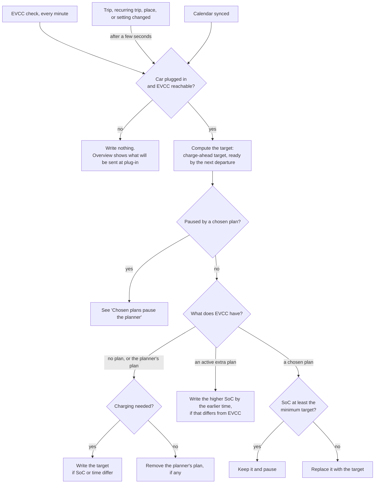
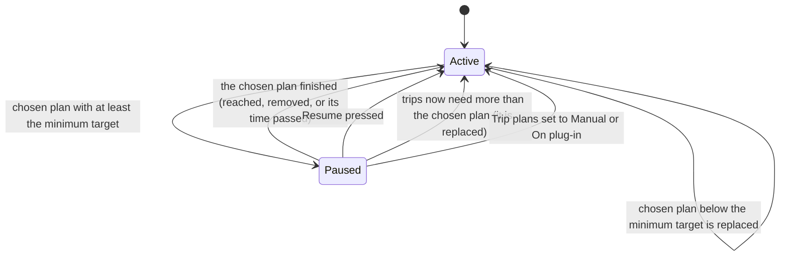
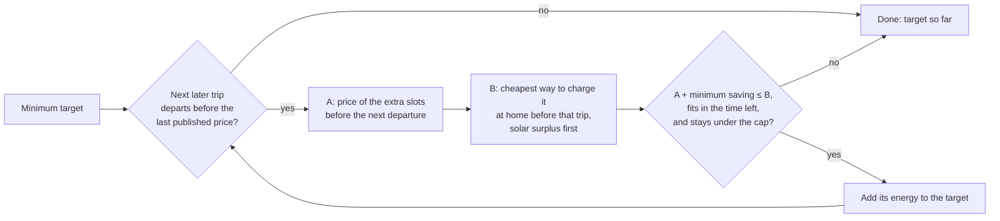
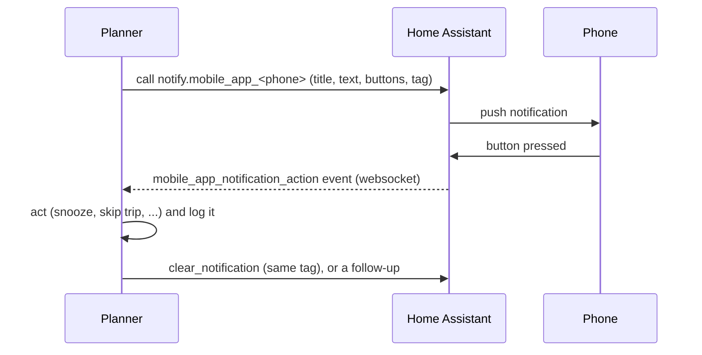

# Automatic plans and notifications

How the planner keeps EVCC's charging plan in line with your trips (V5), and
when it sends notifications to your phone. [PLAN.md](PLAN.md) has the short
version; this file has every rule.

The planner only ever writes the car's **one-off plan** in EVCC: a target SoC
with a ready-by time. EVCC then picks the cheapest slots before that time. The
planner never changes EVCC's mode, its limits, its cheap-charging limit
(except a postponement from daily advice, see V2), or repeating plans.

## Words used here

| Word | Meaning |
| --- | --- |
| **Next departure** | The first trip (or group of overlapping trips) that hasn't left yet. |
| **Minimum target** | The SoC the next departure needs: its own energy plus the arrival reserve, plus later trips the car can't recharge for in between. This is what V1 shows as "Required departure SoC". |
| **Charge-ahead target** | The minimum target plus later trips that are cheaper to charge for before the next departure (see [Charge ahead](#charge-ahead-for-later-trips)). |
| **Planner's plan** | The last plan the automatic check wrote to EVCC. |
| **Chosen plan** | Any other plan in EVCC: set in EVCC itself, or sent by hand with **Send plan to EVCC**. |
| **Extra plan** | A temporary plan from daily advice (V2), which ends at its expiry. |

## Trip plan modes

Settings → Planning → **Trip plans**:

| Mode | What the planner does |
| --- | --- |
| **Manual** | Nothing on its own. You press **Send plan to EVCC**. |
| **On plug-in** | Once, when the car goes from unplugged to plugged in: sends the minimum target, ready by the next departure. A chosen plan with an equal or higher SoC is kept; a lower one is replaced. Nothing is sent when the charge already covers the departure. |
| **Automatic** (default) | Keeps EVCC's plan matched to your trips at all times, while the car is plugged in. Described below. |

Existing installs: the old "plan when plugged in" switch becomes **Automatic**
when it was on, and **Manual** when it was off.

## The automatic check

- **When it runs:** after every EVCC check (every minute by default), a few
  seconds after you change a trip, recurring trip, place or setting, and after
  each calendar sync. New prices (around 14:00) and plugging in are seen by the
  next EVCC check.
- **What it computes:** one SoC target, ready by the next departure. With
  [Charge ahead](#charge-ahead-for-later-trips) on, that's the charge-ahead
  target; otherwise the minimum target.
- **Charging needed** means the car's live SoC is below the target. When it
  isn't (the charge already covers it, or there's no upcoming trip), the
  planner's own plan is removed; EVCC also removes a plan once it's reached.
- **Only while plugged in:** EVCC uses the plan only then, and while unplugged
  its SoC reads 0. While unplugged, the Overview shows "Sends 64% by Thu 07:45
  when plugged in". The first check after plugging in writes it.
- **No back-and-forth:** a write happens only when the whole-percent target or
  the ready-by minute differs from EVCC's plan. Charge-ahead decisions need a
  clear price gap to start (see below).
- **Activity log:** every write, removal, pause, and resume, with source
  "Automation". Checks that change nothing are not logged.
- **EVCC unreachable:** nothing is written; EVCC keeps its plan, and the next
  check tries again.

## Chosen plans pause the planner

A chosen plan is a plan someone picked: set in EVCC, or sent with **Send plan
to EVCC** in the planner. The planner respects it as long as it covers the
next departure.

- **Pause:** in Automatic mode, a chosen plan with at least the minimum target
  pauses automatic changes. It's kept even when its ready-by time is after the
  next departure. The Overview shows "Paused: plan chosen in EVCC Tue 20:14
  (80% by Wed 07:00)" with a **Resume** button.
- **Too low:** a chosen plan below the minimum target is replaced with the
  planner's target right away; trip needs come first. To stop the planner,
  set Trip plans to Manual, turn the trip off, or set EVCC's mode to Off.
- **Resume on its own:** when the chosen plan is gone (EVCC removes a plan once
  it's reached or its time has passed, or someone removed it), automatic plans
  resume and the same check writes the next target.
- **Resume button:** confirms what will be replaced, then checks right away.
- **Mode Off in EVCC:** not a pause. The planner never changes the mode; it
  warns that the plan won't run, and sends a notification when a trip is at
  risk (see [Problems](#charging-problems-questions-and-ready-messages)).

## Extra plans from daily advice

EVCC holds one plan per vehicle, so an active extra plan and the trip target
share it:

- **Merge:** the planner writes the higher SoC with the earlier ready-by time.
  When the extra plan already covers the trip target by the departure, nothing
  is written.
- **End:** at expiry (or **End now**) the earlier plan comes back, or the extra
  plan is removed, as in V2. In Automatic mode the check then takes that plan
  over as its own: once the car is plugged in it updates it to the current
  trip target, or removes it when nothing needs it.
- Sending a trip plan by hand ends an active extra plan, as in V2.
- Advice auto-apply stays a separate setting (Settings → Advice), off by
  default.

## Charge ahead for later trips

With **Charge ahead for later trips** on (Automatic mode only), the target can
include trips after the next departure, when charging for them before the
next departure is clearly cheaper.

- **How far ahead:** up to the last published price in EVCC (usually 24–36
  hours after the ~14:00 update). Later trips keep their own minimum targets.
- **Order:** later trips are checked in date order. The first one that isn't
  cheaper ahead (or doesn't fit, or would pass the cap) ends the check, so the
  target always covers a run of trips without charging in between.
- **A, charge before the next departure:** the extra 15-minute slots the trip
  would need, after the slots the earlier energy already uses, cheapest first,
  between now and the next departure (minus the charging time buffer).
- **B, charge at home just before that trip:** the cheapest way to charge the
  same energy in the home periods between the next departure and that trip.
- **Solar comes first.** No tax is paid on your own solar energy, so a solar
  kWh counts as the grid price at that moment minus **Tax not paid on own
  solar** (default €0.11/kWh). Solar during a €0.20 slot costs €0.09, which
  beats night charging at €0.15.
- **Solar charges at the surplus rate.** Per 15-minute slot, the surplus is the
  solar forecast minus the household use setting. The car charges from it at
  that rate, not at the charger's full power: 2 kW of surplus adds about 1.8
  kWh per hour to the battery. Only the charger's remaining capacity in that
  slot counts as grid energy, at the full price. Surplus below the charger's
  minimum (6 A of 16 A, so about 1.4 kW at 3.68 kW) counts as none, as in
  EVCC's PV mode. A trip's energy is filled from the cheapest pieces first,
  usually solar, so a modest sunny day covers part of a long trip and the
  rest is priced at grid rates. The same valuation applies to both A and B.
- **Limits:** household use is one number for the whole day, while real use
  varies by hour; and EVCC picks the actual slots. The estimate assumes EVCC
  charges from solar between plans (PV or Min+PV mode). Learning an hourly
  household profile from Home Assistant's history could come later.
- **Minimum saving** (default €0.05/kWh): A must be at least this much cheaper
  than B to start charging a trip ahead. Once a trip is charged ahead, it stays
  included while A is still no dearer than B, so small price changes don't
  flip the target back and forth.
- **Cap** (default 90%): charge ahead never raises the target above it. A
  trip's own minimum target can still go up to 100%.
- **Unknown SoC:** no charge ahead; the minimum target is used.
- The energy is in SoC points of the usable capacity; grid energy includes
  charging losses. Prices are EUR/kWh including VAT.

**Example.** Plugged in Wednesday 21:30 at 30%. Thursday: school run at 07:45
(uses 12%, home by 08:45) and Utrecht at 17:00 (uses 37%). The night slots for
the extra charge average €0.23/kWh; the cheapest Thursday daytime slots average
€0.31/kWh, with little sun. (On a sunny Thursday, solar during €0.25 slots
would count as €0.14/kWh, and Utrecht would be charged from the sun instead.)

- Minimum target: 27% (12% + 15% reserve). 30% covers it, so no plan.
- Utrecht ahead: A = €0.23 + €0.05 ≤ B = €0.31, so it's added: 12% + 37% + 15%
  = **64% by Thu 07:45**.
- The Overview says: "Target 64% by Thu 12 Nov, 07:45. Includes Utrecht (Thu
  12 17:00): €0.23/kWh before the next departure vs €0.31/kWh before it, saves
  about €1.94."

EVCC still picks the actual slots. The planner shows its own estimate of them
on the price chart, labelled as an estimate.

## Notifications

Notifications go to the Home Assistant Companion app on your phone. They're
off until you turn them on and choose a phone in Settings → Notifications.

- **Sending:** the planner calls Home Assistant's notify service for each
  chosen phone with the `HA_TOKEN` it already uses. Each message has a title,
  text, up to three buttons, and a tag. A newer message with the same tag
  replaces the old one on the phone; when a message is no longer relevant, the
  planner clears it.
- **Phones:** Settings → Notifications lists Home Assistant's
  `notify.mobile_app_*` services to choose from.
- **Button presses:** the planner keeps a websocket connection to Home
  Assistant and listens for `mobile_app_notification_action` events. No Home
  Assistant automation or YAML is needed, and Home Assistant never has to reach
  the planner. The connection reconnects on its own.
- **View plan** opens the planner, using the **Link address** setting (the
  address your phone uses to reach it). Without one, that button is left out.
- **Test:** **Send test notification** in Settings sends one right away.
- **Activity log:** every message sent (or failed) and every button press,
  with source "Notification" for presses. Tokens never appear.
- **Demo mode:** a stub records the messages; Settings → Notifications shows
  them with their buttons, which act like a press on the phone.
- **Telegram:** a possible later alternative, using the same rules.

## Plug-in reminders

Reminders only go out when all of these hold:

- notifications are on, with a phone chosen;
- the car is unplugged, according to a current EVCC reading;
- no trip is in progress, and (if a car location sensor is set) the car is
  home;
- the plan needs charging before the next departure.

| Reminder | When | Example |
| --- | --- | --- |
| **Early** | 30 min before the first slot of the planned charging (the planner's estimate of EVCC's cheapest slots for the target). If that falls in quiet hours, 15 min before quiet hours start; if that has passed too, when quiet hours end, while the planned charging is still ahead. | "Plug in tonight: charging is cheapest from 01:00 (€0.21/kWh) for Thursday's trips." |
| **Urgent** | 30 min before the latest plug-in time: the next departure, minus the charging time buffer, minus the time to charge the minimum target. | "Plug in by 10:20 to have 52% for Utrecht at 17:00." |
| **Too late** | Once, after the latest plug-in time, if the car is still unplugged. | "Plugging in now gives about 46% by 17:00 (Utrecht needs 52%)." |

The early reminder is about saving money, so it uses the full target. Urgent
and too-late reminders only use the minimum target.

```mermaid
gantt
    title Unplugged Thursday morning, Utrecht at 17:00 needs 34 more SoC points (about 6 h)
    dateFormat HH:mm
    axisFormat %H:%M
    section Car
    Home, unplugged          :08:45, 10:20
    Charging must start      :milestone, 10:20, 0m
    section Reminders
    Urgent reminder          :milestone, 09:50, 0m
    Too late (if still unplugged) :milestone, 10:20, 0m
```

- **Buttons:** **Remind in 30 min**, **Skip trip**, **View plan**.
  - *Remind in 30 min* sends it again after the snooze time, but never later
    than the latest plug-in time.
  - *Skip trip* turns that trip off, as in the UI, re-plans, and confirms:
    "Skipped Utrecht; the new target is 27%."
- **Plugging in** cancels pending reminders and clears them from the phone.
- **No duplicates:** each reminder has one key (kind + trip + time), saved in
  the database, so a restart doesn't resend it. When its details change, the
  same phone notification is updated.
- **Quiet hours** (default 23:00–07:00): early reminders and questions wait
  (or are skipped when their moment has passed). Urgent and too-late reminders
  follow **Urgent reminders in quiet hours**: send (default) or wait until
  quiet hours end.

## Charging problems, questions, and ready messages

| Message | When | Example |
| --- | --- | --- |
| **Charging stopped** | Plugged in below the next departure's minimum target, EVCC says the plan is charging now, but the car hasn't charged for 10 minutes. | "Charging stopped at 48%; Utrecht needs 52% by 17:00." |
| **Unplugged early** | Unplugged more than 30 minutes before the next departure, below its minimum target. | "Unplugged at 48%; Utrecht needs 52% by 17:00." |
| **Charging is off** | Plugged in below the next departure's minimum target, and EVCC's mode is Off. The Overview also warns. | "The plan won't run; Utrecht needs 52% by 17:00." |
| **Missed target** | Unplugged within 30 minutes of the departure with less than its minimum target. Also an activity entry, even with notifications off. | "Left for Utrecht with 48% (target 52%)." |
| **Question** | A calendar event marked Needs review, within the seven days. Buttons: **Count it** (confirm) and **Not a trip** (turn off). | "Is 'Dinner' (Thu 19:00) a car trip?" |
| **Ready** (off by default) | Plugged in and the target reached before the departure. | "Ready for Utrecht: 64%." |

Each is sent once per trip (unplugged early: once per unplug). Charging
stopped and charging off are cleared from the phone once solved. Settings turn
problems, questions, and ready messages on or off separately.

## Settings

Settings → **Planning**:

| Setting | Default | Notes |
| --- | --- | --- |
| Trip plans | Automatic | Manual, On plug-in, or Automatic. |
| Charge ahead for later trips | On | Automatic mode only. |
| Minimum saving | €0.05/kWh | How much cheaper ahead must be to start. |
| Highest target when charging ahead | 90% | Trip needs alone may go higher. |
| Household use during the day | 0.4 kW | Subtracted from the solar forecast. |
| Tax not paid on own solar | €0.11/kWh | A solar kWh counts as the grid price minus this. |

The Planning tab also shows whether automatic plans are active or paused,
with **Resume**.

Settings → **Notifications**:

| Setting | Default |
| --- | --- |
| Notifications | Off |
| Phones | none chosen |
| Link address | empty |
| Car location sensor (optional) | empty |
| Early reminders | On, 30 min before |
| Urgent reminder | 30 min before the latest plug-in time |
| Quiet hours | 23:00–07:00 |
| Urgent reminders in quiet hours | Send |
| Snooze | 30 min |
| Charging problems | On |
| Questions about calendar events | On |
| Ready messages | Off |

## Activity log entries

| Action | Source | Example summary |
| --- | --- | --- |
| `plan.send` | Automation | "Car plugged in: sent plan 64% by Thu 12 Nov, 07:45 to EVCC" / "Automatic plan: sent plan 27% by …" |
| `plan.remove` | Automation | "Automatic plan: removed the planner's plan; the charge already covers the next departure" |
| `plan.keep` | Automation | On plug-in mode: why nothing was sent |
| `control.pause` / `control.resume` | Automation or UI | "Automatic plans paused: plan chosen in EVCC (80% by Wed 07:00)" |
| `plan.missed` | Automation | "Left for Utrecht with 48% (target 52%)" |
| `notification.send` | Automation | "Sent 'Plug in by 10:20' to 1 phone" (failures are logged too) |
| `notification.action` | Notification | "Remind in 30 min pressed: reminder snoozed until 10:20" |

## Tests

- Go API tests run the production wiring in demo mode with a fixed clock: each
  mode, writes and removals, pause and resume, extra-plan merges, charge-ahead
  decisions, each reminder and its quiet-hour handling, deduplication, and
  button actions.
- The charge-ahead calculation is a pure function in `internal/planner` with
  its own table tests.
- Notifications are only sent to the stub in tests; live tests stay read-only.
  The websocket listener is tested against an `httptest` server.
- Playwright covers the Planning and Notifications settings, pause and resume,
  and pressing notification buttons in demo mode.
